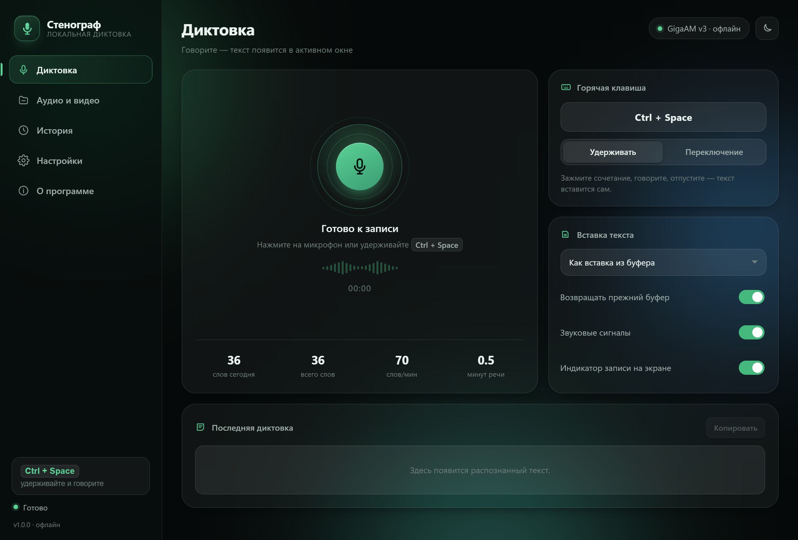
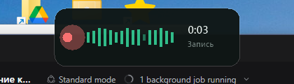
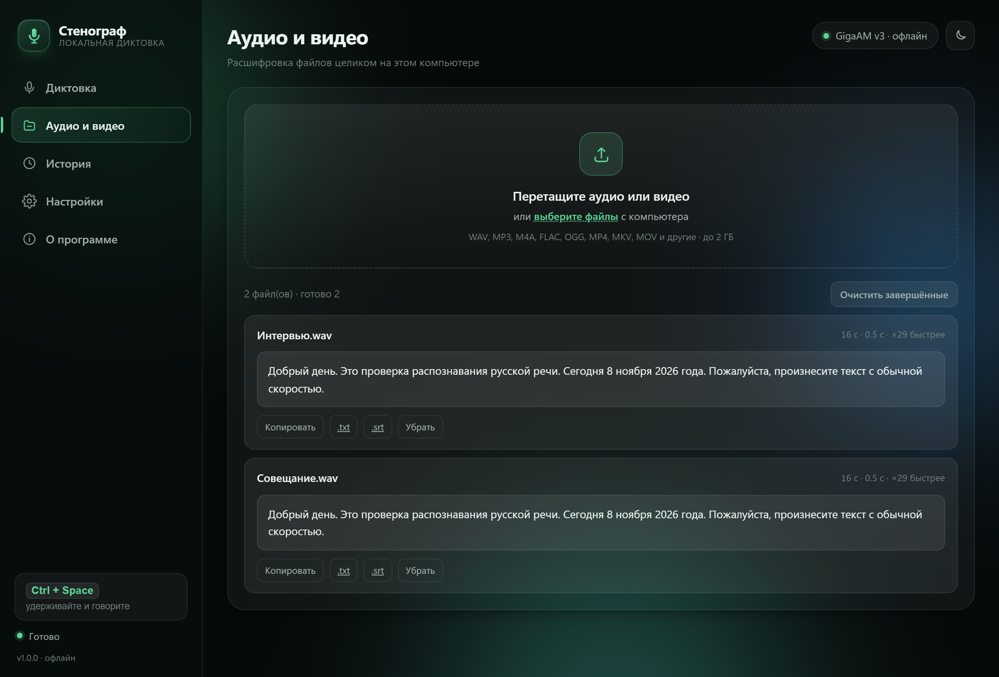
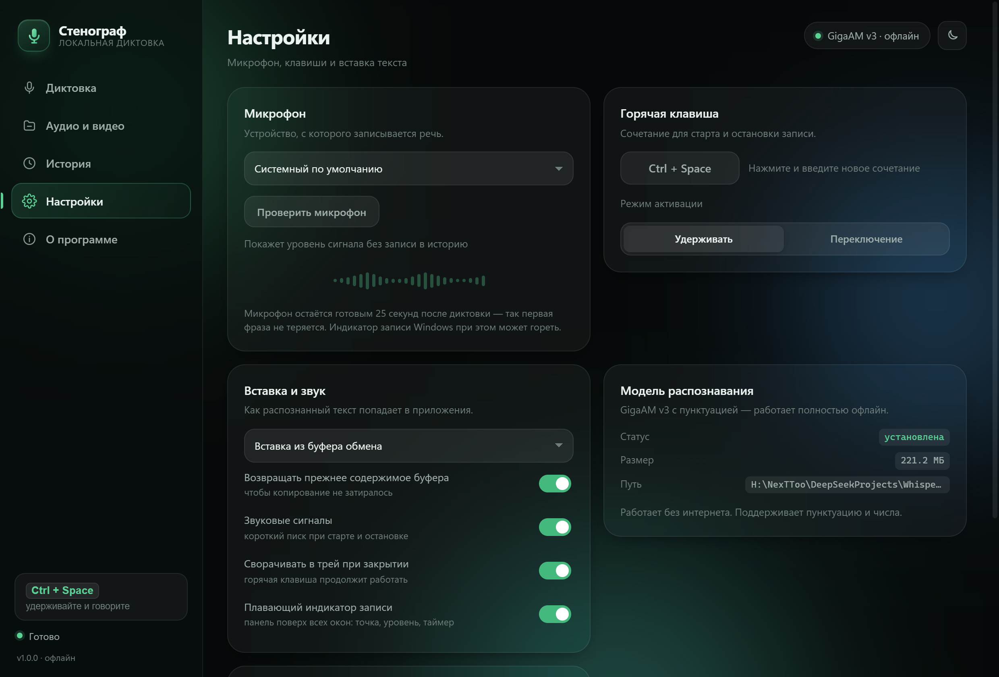

# Стенограф

[](LICENSE)


[](https://github.com/nexttoo/stenograf/releases)

**Стенограф** (Russian for *shorthand writer*) is an offline speech-to-text app for Windows: push-to-talk dictation into any window, plus batch transcription of audio and video files. Everything runs locally — no accounts, no telemetry, no licence keys, no cloud.

Документация на русском: **[README.md](README.md)**



> **Note:** the recognition model is **Russian-only**. The interface is Russian too. The English README is here so the project is understandable and forkable — the engine itself targets Russian speech.

---

## Features

### Dictation into any application

- Hold **`Ctrl + Space`** (configurable) and speak.
- Release — the text is recognised and **inserted into the field that has focus**: Word, browsers, Telegram, WhatsApp, Excel, anything.
- While recording, a **floating indicator** appears at the top of the screen: pulsing dot, live input level and timer. It stays on top of other windows, never steals focus and is click-through.
- Hold-to-talk and toggle modes.
- Every dictation is duplicated to the clipboard and the history — nothing is lost.



### File transcription

Drop files onto the **Audio & video** page.

- `mp3`, `wav`, `m4a`, `aac`, `ogg`, `opus`, `flac`, `wma`, `mp4`, `mkv`, `mov`, `avi`, `webm` and more (via ffmpeg).
- Multiple files are processed in a queue.
- Roughly **20–30× faster than real time** on an ordinary laptop.
- Export to **`.txt`** and **`.srt`** (subtitles with timecodes).



### History and settings

- Searchable history, copy, download, delete; word and speech-rate statistics.
- Microphone selection with a live level test.
- Hotkey, insertion method (clipboard / simulated keystrokes / clipboard only), clipboard restore.
- Light and dark themes, sound cues, minimise to tray.



---

## Installation

> **Download the ready-made installer:** [latest release](https://github.com/nexttoo/stenograf/releases/latest) — `Stenograf-Setup-1.0.1.exe` (no administrator rights required). A portable `Stenograf-1.0.1-portable.zip` is attached to the same release.

The installer is **per-user**:

- installs to `%LOCALAPPDATA%\Programs\Stenograf`;
- desktop shortcut;
- optional shortcut in the **Startup** folder;
- Start-menu entries: app, readme, licences, uninstall;
- uninstall through «Settings → Apps», asking whether to keep your history.

Silent mode: `Stenograf-Setup-1.0.1.exe /VERYSILENT /NORESTART`.

**Portable build**: unzip and run `Stenograf.exe`. The model and ffmpeg are included; no internet needed.

---

## Build from source

Requires **Windows 10/11 x64** and **Python 3.12**.

```bash
git clone https://github.com/nexttoo/stenograf.git
cd stenograf

python -m pip install -r requirements.txt

python scripts/fetch_model.py     # GigaAM v3 (punct), 221 MB from HuggingFace
python scripts/get_ffmpeg.py      # ffmpeg LGPL build, 167 MB (needed for mp3/mp4)

python app/main.py                # run from source
python build.py                   # build the portable folder dist/Stenograf
python build_installer.py         # build the installer (requires Inno Setup 6)
```

The model and ffmpeg are **not stored in the repository** — the scripts fetch them. This is deliberate: the model file is 214 MB (above GitHub's per-file limit) and binaries do not belong in git.

### Layout

```
app/
  main.py              entry point: server, window, tray, shutdown
  whcs/
    config.py          settings, history, paths
    audio.py           file decoding, microphone capture, sound cues
    asr.py             sherpa-onnx engine, long-audio segmentation, text cleanup
    dictation.py       global hotkey, text insertion, dictation flow
    overlay.py         floating recording indicator (GDI+, layered window)
    server.py          stdlib HTTP server and JSON API
  web/                 UI: index.html, styles.css, app.js
scripts/               model and ffmpeg downloaders
installer/             Inno Setup script
docs/                  screenshots, third-party licences
build.py               portable build (PyInstaller)
build_installer.py     installer build (Inno Setup)
```

---

## How it works

A few decisions worth knowing if you plan to fork.

**Model — GigaAM v3 (punct), int8.** ~221 MB, CPU-only, restores punctuation and capitalisation itself and writes numbers as digits. Inference goes through `sherpa-onnx` (ONNX Runtime inside).

**The hotkey is a low-level `WH_KEYBOARD_LL` hook, not `RegisterHotKey`.** Combinations containing `Space` (`Ctrl+Space`, `Ctrl+Shift+Space`) register successfully on many systems but never deliver `WM_HOTKEY` — the input subsystem (IME) swallows them. The hook always sees key down and key up, and swallows the chord so no stray character is typed into the target app.

**The microphone stays warm for 25 seconds** after dictation: the first ~0.24 s after a stream is opened is lost, so without warm-up the first syllable would be clipped.

**Device and sample-rate selection tries several options** (16 kHz → native rate → 48/44.1 kHz) and falls back to the system default device: WASAPI does not always accept 16 kHz (`AUDCLNT_E_UNSUPPORTED_FORMAT`).

**Text insertion** uses the clipboard (restoring the previous contents) or simulated keystrokes (`SendInput`, Unicode). Whether to insert into a foreign window is decided by the **real foreground window**, not by a flag coming from the browser — otherwise the "UI is focused" flag sticks when the window is closed.

**The UI** is plain HTML/CSS/JS served by a stdlib Python HTTP server (no FastAPI or other frameworks). The window is Chrome/Edge running in app mode.

**The floating indicator** is a native layered window painted with GDI+ (per-pixel alpha, 30 fps), click-through and without focus stealing.

---

## Requirements

- Windows 10 (1809+) or Windows 11, x64.
- A Chromium browser for the app window: Edge (ships with Windows) or Chrome. Without them the app opens in the default browser.
- ~1 GB RAM, ~600 MB disk.
- For building: Python 3.12 and, for the installer, Inno Setup 6.

---

## Data and privacy

Everything lives in the `data` folder next to the program (or in `%APPDATA%\Stenograf` if the folder is not writable):

| What | Path |
|---|---|
| Settings | `data/config.json` |
| History | `data/history.json` |
| Log | `data/whispercs.log` |
| Temporary files | `data/tmp`, `data/uploads` |

- The app makes no network requests. The only exception is the **Download model** button (HuggingFace) when the model is missing.
- No telemetry, analytics, advertising identifiers, licence checks or auto-updates.
- The microphone is opened only while dictating (+25 s warm window).

---

## Limitations

- **Russian speech only** (the model is monolingual).
- No voice commands or LLM-based text editing — this is deliberately a small, focused tool.
- Applications running **as administrator** do not accept input from normal processes (Windows security). To dictate into such a window, run Стенограф as administrator too.

---

## Troubleshooting

| Symptom | What to do |
|---|---|
| Hotkey does nothing | Pick another combination in Settings — some chords are taken by the system or other apps |
| Text is not inserted | Switch the insertion method to "Simulated keystrokes" |
| Window closed but dictation works | By design: the app lives in the tray. The icon is in the notification area (maybe under `^`) |
| mp3/mp4 does not open | `tools/ffmpeg.exe` is missing — run `python scripts/get_ffmpeg.py` |
| Microphone is silent | Check the hardware mute switch and «Settings → Privacy → Microphone» |
| Need diagnostics | `data/whispercs.log` — startup, errors and the dictation log |

---

## License

The project code is **MIT** — see [LICENSE](LICENSE). Take it, change it, use it in your products; just keep the licence text.

The GigaAM v3 model is distributed separately under **MIT** (© GigaChat Team). The full list of third-party components and their licences is in [docs/LICENSES.md](docs/LICENSES.md).

Issues and pull requests are welcome — in Russian or English.
