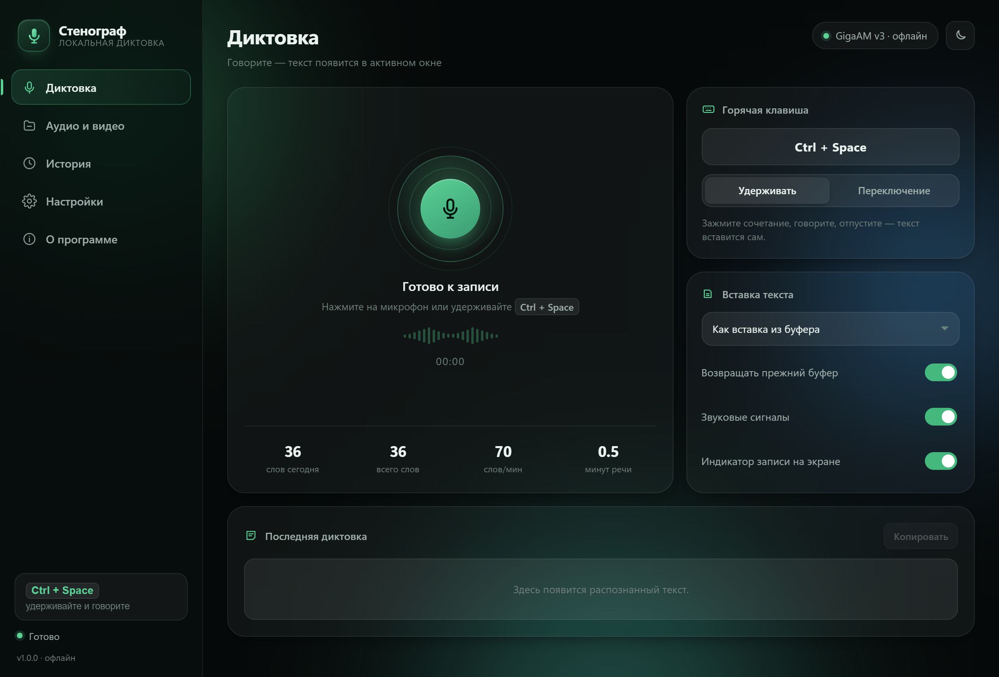
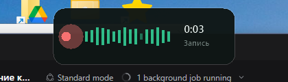
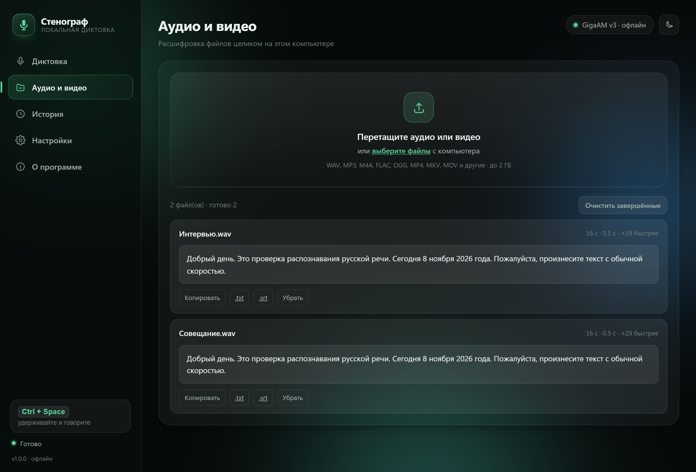
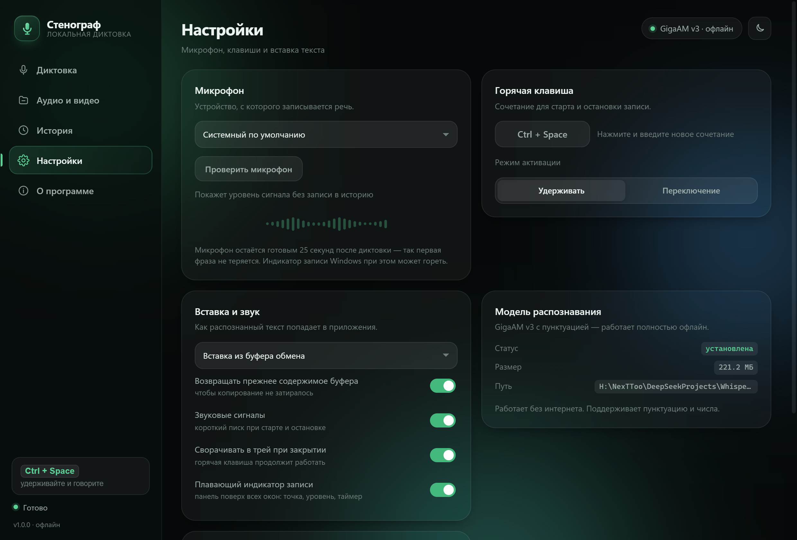

# Стенограф

[](LICENSE)


[](https://github.com/nexttoo/stenograf/releases)

**Русский** · [English](README.en.md)

**Локальная диктовка и расшифровка аудио/видео на русском языке для Windows.**
Работает целиком на вашем компьютере: без интернета, без аккаунтов, без телеметрии и без отправки данных на серверы.



---

## Возможности

### Диктовка в любое окно

- Зажмите **`Ctrl + Space`** (сочетание настраивается) и говорите.
- Отпустите — текст распознаётся и **вставляется в то приложение, где стоит курсор**: Word, браузер, Telegram, WhatsApp, Excel, блокнот.
- Пока идёт запись, вверху по центру появляется **плавающий индикатор**: пульсирующая точка, живой уровень сигнала и таймер. Он виден поверх всех окон, не забирает фокус и не мешает кликам мышью.
- Режимы «Удерживать» и «Переключение».
- Распознанный текст всегда дублируется в буфер обмена и в историю.



### Расшифровка файлов

Раздел «Аудио и видео»: перетащите файлы в окно.

- `mp3`, `wav`, `m4a`, `aac`, `ogg`, `opus`, `flac`, `wma`, `mp4`, `mkv`, `mov`, `avi`, `webm` и другие (через ffmpeg).
- Несколько файлов — очередь обработки.
- Примерно **в 20–30 раз быстрее реального времени** на обычном ноутбуке.
- Экспорт **`.txt`** и **`.srt`** (субтитры с тайм-кодами).



### История и настройки

- Поиск по истории, копирование, скачивание, удаление; статистика слов и скорости речи.
- Выбор микрофона с проверкой уровня сигнала.
- Горячая клавиша, способ вставки (буфер / симуляция клавиш / только копирование), возврат прежнего буфера.
- Светлая и тёмная темы, звуковые сигналы, сворачивание в трей.



---

## Установка

> **Скачать готовый установщик:** [последний релиз](https://github.com/nexttoo/stenograf/releases/latest) — `Stenograf-Setup-1.0.1.exe`, права администратора не нужны.

**Установщик** `Stenograf-Setup-1.0.1.exe` — ставит для текущего пользователя, **без прав администратора**:

- копирует программу в `%LOCALAPPDATA%\Programs\Stenograf`;
- ярлык на рабочем столе;
- по желанию — ярлык в **папке «Автозагрузка»**;
- меню «Пуск»: программа, инструкция, лицензии, удаление;
- удаление через «Параметры → Приложения», с вопросом о сохранении истории.

Тихий режим: `Stenograf-Setup-1.0.1.exe /VERYSILENT /NORESTART`.

**Портативный вариант**: скачайте `Stenograf-1.0.1-portable.zip` из [релизов](https://github.com/nexttoo/stenograf/releases/latest), распакуйте и запустите `Stenograf.exe`. Модель и ffmpeg уже внутри, интернет не нужен.

---

## Сборка из исходников

Нужны **Windows 10/11 x64** и **Python 3.12**.

```bash
git clone https://github.com/<ваш-аккаунт>/stenograf.git
cd stenograf

python -m pip install -r requirements.txt

python scripts/fetch_model.py     # GigaAM v3 (punct), 221 МБ с HuggingFace
python scripts/get_ffmpeg.py      # ffmpeg LGPL, 167 МБ (необязательно, но нужен для mp3/mp4)

python app/main.py                # запуск из исходников
python build.py                   # сборка портативной папки dist/Stenograf
python build_installer.py          # сборка установщика (нужен Inno Setup 6)
```

Модель и ffmpeg **не хранятся в репозитории** — их скачивают скрипты. Это осознанно: файл модели 214 МБ превышает лимит GitHub, а бинарники в git — плохая практика.

### Структура

```
app/
  main.py              точка входа: сервер, окно, трей, выход
  whcs/
    config.py          настройки, история, пути
    audio.py           декодирование файлов, запись с микрофона, сигналы
    asr.py             движок sherpa-onnx, разбиение длинных записей, нормализация текста
    dictation.py       глобальная клавиша, вставка текста, сценарий диктовки
    overlay.py         плавающий индикатор записи (GDI+, слоистое окно)
    server.py          HTTP-сервер на стандартной библиотеке и JSON API
  web/                 интерфейс: index.html, styles.css, app.js
scripts/               загрузка модели и ffmpeg
installer/             сценарий Inno Setup
docs/                  скриншоты, список лицензий
build.py               сборка портативной версии (PyInstaller)
build_installer.py     сборка установщика (Inno Setup)
```

---

## Как это устроено

Несколько решений, которые стоит знать, если будете форкать.

**Модель — GigaAM v3 (punct), int8.** ~221 МБ, работает на CPU, ставит пунктуацию и заглавные буквы сама, числа пишет цифрами. Инференс — через `sherpa-onnx` (ONNX Runtime внутри).

**Горячая клавиша — низкоуровневый хук `WH_KEYBOARD_LL`, а не `RegisterHotKey`.** Сочетания с `Space` (`Ctrl+Space`, `Ctrl+Shift+Space`) на многих системах регистрируются, но событие `WM_HOTKEY` не приходит — их перехватывает подсистема ввода (IME). Хук видит нажатие и отпускание всегда и «проглатывает» сочетание, чтобы символ не печатался в чужом окне.

**Микрофон держится «тёплым» 25 секунд** после диктовки: первые ~0,24 с после открытия потока теряются, и без прогрева обрезался бы первый слог.

**Выбор устройства и частоты** — с перебором вариантов (16 кГц → родная → 48/44,1 кГц) и откатом на системное устройство: WASAPI не всегда принимает 16 кГц (`AUDCLNT_E_UNSUPPORTED_FORMAT`).

**Вставка текста** — буфер обмена с восстановлением прежнего содержимого либо симуляция клавиш (`SendInput`, Unicode). Вставлять ли текст в чужое окно, определяется по **реальному активному окну Windows**, а не по признаку из браузера: иначе флаг «интерфейс в фокусе» залипает при закрытии окна.

**Интерфейс** — обычные HTML/CSS/JS, отдаваемые локальным сервером на стандартной библиотеке Python (без FastAPI и прочих зависимостей). Окно — Chrome/Edge в режиме приложения.

**Плавающий индикатор** — нативное слоистое окно с отрисовкой через GDI+ (per-pixel alpha, 30 кадров в секунду), прозрачное для мыши и без захвата фокуса.

---

## Требования

- Windows 10 (1809+) или Windows 11, x64.
- Chromium-браузер для окна: Edge (есть в системе) или Chrome. Без них программа откроется в браузере по умолчанию.
- ~1 ГБ оперативной памяти, ~600 МБ на диске.
- Для сборки — Python 3.12 и, для установщика, Inno Setup 6.

---

## Данные и приватность

Всё лежит в папке `data` рядом с программой (или в `%APPDATA%\Stenograf`, если папка недоступна для записи):

| Что | Путь |
|---|---|
| Настройки | `data/config.json` |
| История | `data/history.json` |
| Журнал | `data/stenograf.log` |
| Временные файлы | `data/tmp`, `data/uploads` |

- Программа не делает сетевых запросов. Единственное исключение — кнопка «Скачать модель» (HuggingFace), если модель отсутствует.
- Нет телеметрии, аналитики, рекламных идентификаторов, проверок лицензии и автообновлений.
- Микрофон открывается только на время диктовки (+25 секунд «тёплого» режима).

---

## Ограничения

- Распознаётся **русский язык** (модель моноязычная); английские вставки — частично.
- Нет голосовых команд и ИИ-редактирования текста — это осознанно простая версия.
- Приложения, запущенные от администратора, не принимают ввод от обычных программ (защита Windows): если нужно диктовать в такое окно, запустите и Стенограф от администратора.

---

## Если что-то не работает

| Симптом | Что делать |
|---|---|
| Горячая клавиша не реагирует | Смените сочетание в настройках: часть комбинаций занимает система или другие программы |
| Текст не вставляется | Переключите способ вставки на «Симуляция клавиш» |
| Окно закрылось, но запись работает | Так и задумано: программа в трее. Значок — в области уведомлений (возможно под стрелкой `^`) |
| Не открывается mp3/mp4 | Нет `tools/ffmpeg.exe` — запустите `python scripts/get_ffmpeg.py` |
| Микрофон молчит | Проверьте Mute на устройстве и «Параметры → Конфиденциальность → Микрофон» |
| Нужна диагностика | `data/stenograf.log` — запуск, ошибки и журнал диктовки |

---

## Лицензия

Код проекта — **MIT**, см. [LICENSE](LICENSE). Берите, меняйте, используйте в своих продуктах; достаточно сохранить текст лицензии.

Модель GigaAM v3 распространяется отдельно под **MIT** (© GigaChat Team). Список всех сторонних компонентов и их лицензий — в [docs/LICENSES.md](docs/LICENSES.md).

Замечания и pull request'ы приветствуются. Если делаете форк под свои задачи — достаточно упомянуть авторов.
